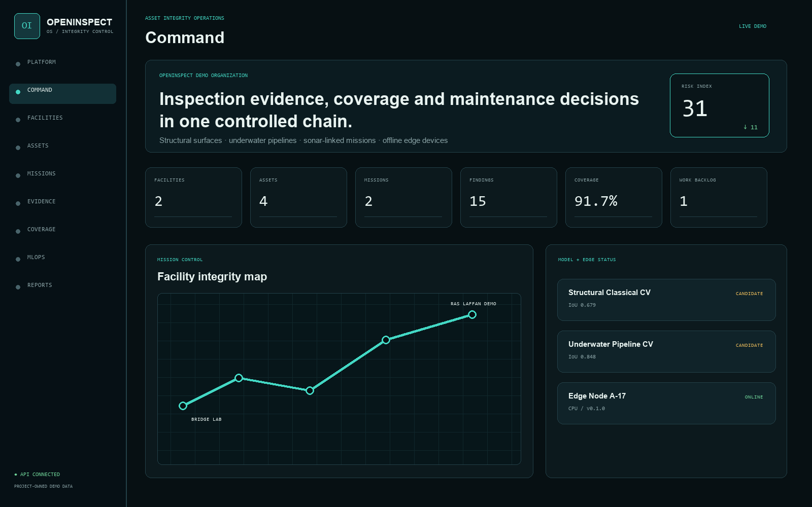
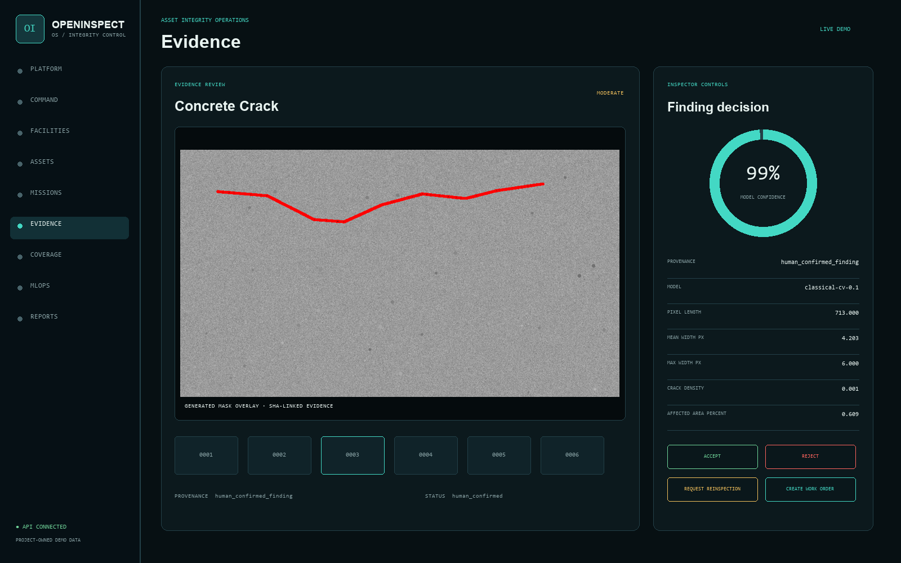
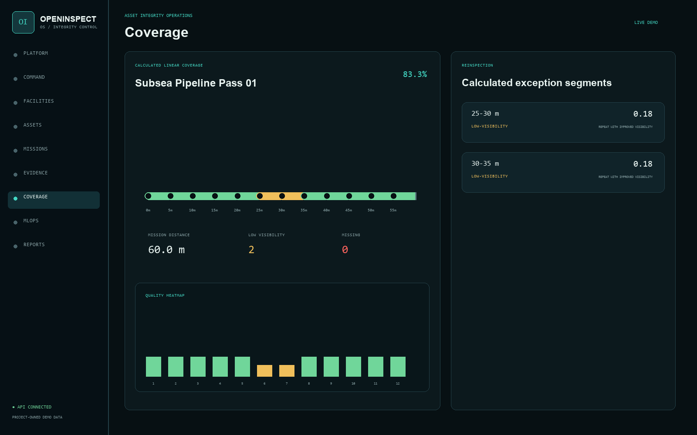
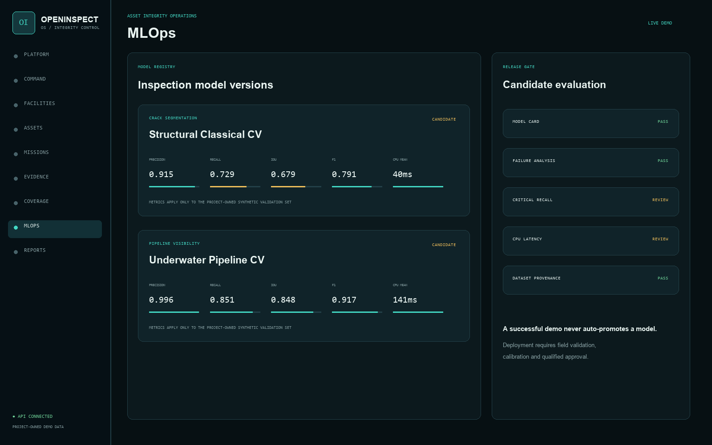
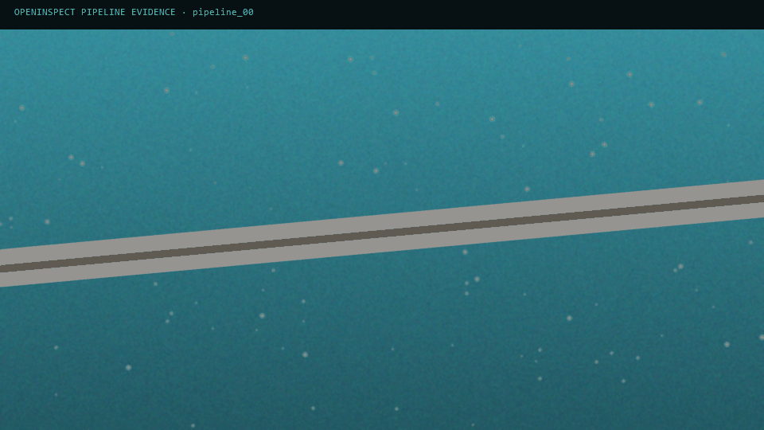
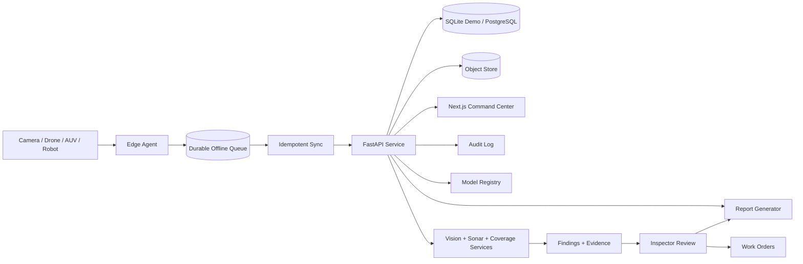
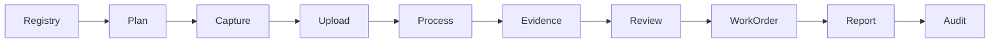

# OpenInspect OS

[](LICENSE)
[](pyproject.toml)
[](apps/api/openinspect_api/main.py)
[](apps/web/package.json)
[](infra/compose/docker-compose.yml)
[](https://github.com/HUSNAIN-MUNAWAR/openinspect-os/actions/workflows/ci.yml)

**OpenInspect OS is an open-source inspection operations platform that connects computer-vision evidence, sonar/navigation context, human review, work orders, reporting and offline edge synchronization.**

It is built for engineers, researchers and inspection teams who need a credible reference system for multimodal asset inspection workflows without bundling proprietary customer data or unverifiable field-performance claims.

> Status: engineering reference implementation and reproducible CPU demo. OpenInspect OS is not a certified NDT instrument and does not claim field-grade corrosion, crack-width or structural-integrity performance.

## Why This Exists

Inspection software often stops at either raw model output or generic asset records. OpenInspect OS demonstrates the complete operational chain around inspection evidence: capture ingestion, deterministic processing, tenant-scoped persistence, review, maintenance follow-up, reports, audit history, model governance and disconnected edge replay. The default demo uses project-owned synthetic media so the repository can be run, tested and shared publicly.

## Screenshots

The screenshots below are captured from the local web application using generated project-owned demo state.



| Evidence review | Coverage exceptions |
|---|---|
|  |  |

| Model registry | Evidence sequence |
|---|---|
|  |  |

## What Runs Today

- Multi-tenant FastAPI backend for organizations, facilities, assets, plans, missions, uploads, findings, reviews, work orders, reports, model versions, edge devices, sync events and audit logs.
- Structural surface analysis with quality scoring, mask generation, skeleton length, width estimation, affected area, severity rules and evidence overlays.
- Underwater pipeline workflow with image enhancement, visibility segmentation, sonar peak candidates, timestamp alignment, navigation-linked coverage and exception segments.
- Human review loop that can accept, reject, request reinspection and create maintenance work orders from persisted findings.
- Query-driven PDF reports with checksums and audit-linked provenance.
- Offline edge agent with durable JSON queueing and idempotent sync replay protection.
- Next.js command center for dashboard, facilities, assets, missions, evidence review, coverage, MLOps and reports.
- Python SDK and CLI entry point for edge/demo workflows.
- Docker, Kubernetes and monitoring examples for deployment-oriented readers.

## Architecture





See [docs/ARCHITECTURE.md](docs/ARCHITECTURE.md) for deeper service boundaries and deployment diagrams.

## Technology Stack

| Layer | Stack |
|---|---|
| Backend | Python 3.11+, FastAPI, SQLAlchemy, Alembic, Pydantic, PyJWT |
| CV and reporting | OpenCV, NumPy, scikit-image, Pillow, ReportLab |
| Web | Next.js, React, TypeScript, MapLibre GL |
| Storage | SQLite for the demo path, PostgreSQL/PostGIS and object storage for deployment examples |
| Edge | Python CLI, durable local queue, replay-safe sync envelopes |
| Infra | Docker Compose, Dockerfiles, Kubernetes manifest, Prometheus config |
| Quality | pytest, ruff, mypy, Node test runner, TypeScript build |

## Quick Start

```bash
git clone https://github.com/HUSNAIN-MUNAWAR/openinspect-os.git
cd openinspect-os
python -m pip install -e .[dev]
python scripts/run_demo.py
pytest
```

On Windows, use `py` if `python` is not on PATH:

```powershell
py -m pip install -e .[dev]
py scripts/run_demo.py
py -m pytest
```

`scripts/run_demo.py` generates project-owned media, evaluates the deterministic CV baselines, creates demo facilities/assets/missions, processes findings, records review/work-order/model/sync/audit data and renders PDF reports.

Key generated outputs:

```text
demo/outputs/demo_summary.json
demo/outputs/model_performance.json
demo/outputs/openinspect_demo.db
demo/outputs/reports_manifest.json
demo/outputs/pipeline_evidence.gif
demo/outputs/sample-mission-report.pdf
demo/outputs/sample-coverage-report.pdf
```

## Run Locally

### Backend

```bash
export OPENINSPECT_DATABASE_URL="sqlite:///$(pwd)/demo/outputs/openinspect_demo.db"
export OPENINSPECT_OBJECT_ROOT="$(pwd)/demo/outputs/object-store"
PYTHONPATH=.:apps/api uvicorn openinspect_api.main:app --host 0.0.0.0 --port 8000 --reload
```

PowerShell:

```powershell
$env:OPENINSPECT_DATABASE_URL = "sqlite:///$((Get-Location).Path.Replace('\','/'))/demo/outputs/openinspect_demo.db"
$env:OPENINSPECT_OBJECT_ROOT = "$((Get-Location).Path)/demo/outputs/object-store"
$env:PYTHONPATH = ".;apps/api"
py -m uvicorn openinspect_api.main:app --host 0.0.0.0 --port 8000 --reload
```

OpenAPI docs are available at `http://localhost:8000/docs`.

### Frontend

```bash
cd apps/web
npm install
NEXT_PUBLIC_API_URL=http://localhost:8000 npm run dev
```

PowerShell:

```powershell
cd apps/web
npm install
$env:NEXT_PUBLIC_API_URL = "http://localhost:8000"
npm run dev
```

Open `http://localhost:3000`.

## Configuration

Copy [.env.example](.env.example) to `.env` for local overrides. Do not commit real secrets.

| Variable | Purpose | Demo default |
|---|---|---|
| `OPENINSPECT_ENV` | Runtime environment label | `development` |
| `OPENINSPECT_DATABASE_URL` | SQLAlchemy database URL | SQLite demo database |
| `OPENINSPECT_OBJECT_ROOT` | Local/object-store evidence root | `demo/outputs/object-store` |
| `OPENINSPECT_JWT_SECRET` | JWT signing secret | development placeholder only |
| `OPENINSPECT_ACCESS_TOKEN_MINUTES` | Token lifetime | `60` |
| `OPENINSPECT_ALLOWED_ORIGINS` | CORS origins | `http://localhost:3000` |
| `NEXT_PUBLIC_API_URL` | Web app API base URL | `http://localhost:8000` |

## API Examples

```bash
curl http://localhost:8000/health
curl http://localhost:8000/dashboard
curl http://localhost:8000/findings
```

```python
from openinspect_sdk import OpenInspectClient

client = OpenInspectClient("http://localhost:8000")
print(client.dashboard())
```

## CLI Examples

```bash
openinspect-edge --help
python scripts/run_demo.py
python ml/evaluation/evaluate_demo.py
```

The edge agent is intentionally small: it demonstrates local processing, durable queued sync envelopes and duplicate replay handling. See [apps/edge-agent/README.md](apps/edge-agent/README.md).

## Testing And Validation

Python:

```bash
python -m pip install -e .[dev]
python scripts/run_demo.py
ruff check .
mypy services apps/api/openinspect_api
pytest --cov=services --cov=openinspect_api
```

Frontend:

```bash
cd apps/web
npm install
npm run typecheck
npm test
npm run build
```

Docker:

```bash
docker compose -f infra/compose/docker-compose.yml up --build
```

CI runs Python lint/type/test/demo checks, frontend type/test/build checks, container builds and non-blocking Trivy filesystem scanning.

## Project Structure

```text
apps/api                 FastAPI service and SQLAlchemy domain model
apps/web                 Next.js inspection command center
apps/edge-agent          Local edge processing and durable sync CLI
services/vision          Structural, underwater and temporal processing
services/sonar           Sonar CSV parsing and candidate detection
services/localization    Trajectory and coverage calculations
services/change_detection Image registration and changed-region analysis
services/reporting       ReportLab PDF reports
packages/python-sdk      Minimal API client
datasets                 Registry, adapters and project-owned demo data
ml                       Evaluation scripts and model cards
infra                    Docker, Compose, Kubernetes and monitoring examples
docs                     Architecture, datasets, workflow, deployment and security docs
tests                    Unit and integration tests
```

## Data And Attribution

The repository redistributes only generated project-owned demonstration data. It is documented in [datasets/project-owned/DATASET_CARD.md](datasets/project-owned/DATASET_CARD.md) and licensed CC BY 4.0.

Optional external dataset adapters are included, but the external datasets themselves are not redistributed:

- SDNET2018 structural adapter: users must obtain data from the official source and preserve its license terms.
- SubPipe adapter: users must obtain RGB/sonar/navigation data from the official publisher and preserve required attribution.

See [docs/DATASETS.md](docs/DATASETS.md), [datasets/registry.yaml](datasets/registry.yaml) and [THIRD_PARTY_NOTICES.md](THIRD_PARTY_NOTICES.md).

## Security Notes

OpenInspect OS includes password hashing, JWT primitives, upload size/type controls, tenant-scoped lookups, isolated object paths, SHA-256 checksums, replay-safe sync IDs and audit events. These are reference controls, not a production security certification.

Critical-infrastructure deployment still requires external identity, TLS/mTLS, managed secrets, malware scanning or content disarm, signed object URLs, database row-level security, append-only audit storage, SBOMs and hardware-backed edge identity. See [SECURITY.md](SECURITY.md) and [docs/SECURITY.md](docs/SECURITY.md).

## Known Constraints

- The default dataset is intentionally small and synthetic; metrics are software-validation results, not field performance.
- Physical crack dimensions are emitted only when calibration metadata exists.
- Pipeline analysis identifies visibility/candidate regions; it does not diagnose corrosion.
- Sonar processing returns candidate range bins that require qualified interpretation.
- The default demo uses SQLite and local files; deployment examples show PostgreSQL/PostGIS and object storage.
- Full SLAM is not fabricated; the current coverage path uses timestamped navigation/GPS trajectory data.

## Roadmap

- Add a worker service for asynchronous processing jobs.
- Add signed object URLs and managed object storage integration.
- Add richer calibration metadata and uncertainty propagation.
- Expand project-owned validation scenarios and failure-case reports.
- Add OpenTelemetry traces and stronger deployment health checks.
- Add optional ONNX Runtime/OpenVINO inference plugins behind the existing processing contracts.

## Contributing

Contributions are welcome when they preserve provenance, reproducibility and human review. Please read [CONTRIBUTING.md](CONTRIBUTING.md), use the issue templates and include tests for measurement, tenant isolation, sync idempotency or report behavior when relevant.

Do not submit proprietary inspection media, customer identifiers, credentials or unlicensed datasets.

## License

Code is licensed under [Apache-2.0](LICENSE). Project-owned demonstration data is licensed CC BY 4.0. External dataset and library terms remain with their publishers and authors.
